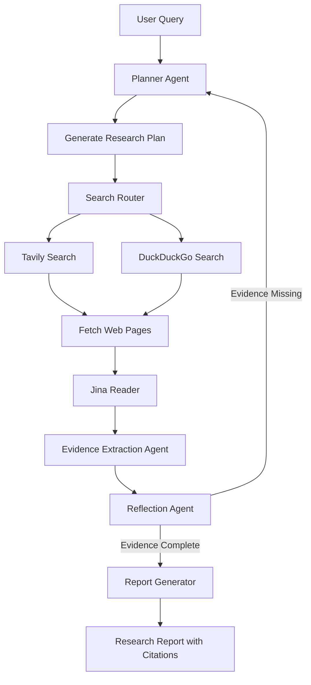
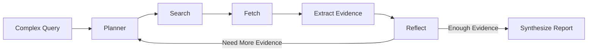
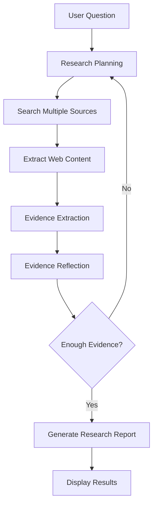

# AI Research Agent 

An advanced **multi-agent AI research system** that autonomously decomposes complex research questions, performs iterative web searches, extracts evidence, evaluates information quality, and synthesizes comprehensive, citation-backed research reports.

Built with **LangGraph**, **LangChain**, **OpenRouter**, **Gradio**, and modern search APIs, the agent employs **cyclic reasoning and self-reflection** to improve answer quality before generating a final report.

---

#  Features

-  **Stateful Multi-Agent Workflow** powered by LangGraph
-  **Dual-Loop Agentic Reasoning** with planning, reflection, and re-planning
-  **Dynamic Query Decomposition** into atomic research tasks
-  **Multi-Source Web Search** using Tavily with DuckDuckGo fallback
-  **Automatic Webpage Extraction** using Jina Reader
-  **Evidence-Based Report Generation** with citations
-  **Self-Evaluation & Gap Detection** before final synthesis
-  **Live Progress Tracking** through an interactive Gradio interface
-  **Dockerized Deployment**
-  Support for multiple OpenRouter models (Claude, GPT-4o, Gemini, etc.)

---

# System Architecture



---

# Agent Workflow



---

# Technology Stack

| Category | Technologies |
|-----------|--------------|
| **AI Frameworks** | LangGraph, LangChain |
| **LLMs** | OpenRouter, Claude 3.5 Sonnet, GPT-4o, Gemini 1.5 |
| **Search** | Tavily API, DuckDuckGo |
| **Content Extraction** | Jina Reader |
| **Networking** | HTTPX |
| **Frontend** | Gradio |
| **Deployment** | Docker |
| **Language** | Python |

---

# Local Installation

## Prerequisites

- Python 3.11+
- OpenRouter API Key
- *(Optional)* Tavily API Key

---

## Clone Repository

```bash
git clone https://github.com/your-username/your-repository.git

cd your-repository
```

---

## Create Virtual Environment

### Windows

```bash
python -m venv .venv

.venv\Scripts\activate
```

### Linux / macOS

```bash
python -m venv .venv

source .venv/bin/activate
```

---

## Install Dependencies

```bash
pip install -r requirements.txt
```

---

## Configure Environment Variables

Create a `.env` file:

```env
OPENROUTER_API_KEY=your_api_key

TAVILY_API_KEY=your_tavily_key

OPENROUTER_MODEL=anthropic/claude-3.5-sonnet
```

---

## Run the Application

```bash
python app.py
```

Open your browser:

```
http://127.0.0.1:7860
```

---

# Docker Deployment

## Build Image

```bash
docker build -t research-agent .
```

## Run Container

```bash
docker run -d \
--name research-agent \
-p 7860:7860 \
--env-file .env \
research-agent
```

Visit:

```
http://localhost:7860
```

---

# Usage Guide

1. Launch the application.
2. Enter a complex research question.
3. Choose your preferred OpenRouter model.
4. Adjust the research iteration slider.
5. Start the research process.
6. Review the generated report with citations and confidence metrics.

---

# Research Pipeline



---

# Project Structure

```text
.
├── app.py                 # Gradio Interface
├── research_agent.py      # LangGraph Workflow
├── requirements.txt
├── Dockerfile
├── .dockerignore
├── .env
└── README.md
```

---

# Skills Demonstrated

- LangGraph
- Multi-Agent Systems
- Agentic AI
- Large Language Models (LLMs)
- Prompt Engineering
- Retrieval-Augmented Generation (RAG)
- Web Search Automation
- Information Extraction
- Self-Reflective AI Systems
- Docker
- API Integration
- Production AI Engineering

---

# Future Improvements

- PDF & document ingestion
- Persistent semantic memory
- Multimodal research
- Citation verification
- Knowledge graph generation
- Parallel research agents
- Export reports to PDF & Markdown
- Research history database
- User authentication
- Kubernetes deployment

---

**If you found this project useful, consider giving it a Star!**

> **"Autonomous AI agents transform search into intelligent research."**
